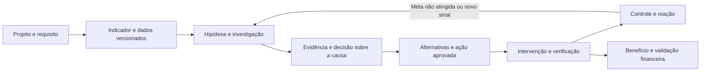

# Plano de implementação do Roadmap DMAIC derivado das aulas

Data: 13/11/2026. Estado: Iteração 0 em andamento no fluxo local; persistência, triagem reforçada e workspace DMAIC foram implementados e passaram por validação de navegador e regressões locais. A integração corporativa/API, aprovações formais e validação independente dos métodos industriais seguem pendentes.

## Escopo e relação com o planejamento existente

Este plano transforma o bloco de seis aulas especiais do Green Belt já revisadas em decisões para o SigmaFlow: 0.1 (Roadmap), 11.1 (Definir), 32.6 (Analisar), 32.7 (desenvolvimento financeiro), 36.1 (Implementar) e 43.1 (Controlar). O restante do curso continua em estudo. A fase Medir aparece aqui pelas dependências descritas nesse bloco e pelas capacidades existentes; este documento não representa revisão completa de todas as suas aulas ou métodos.

As fontes e divergências dos exemplos estão registradas em [ACOMPANHAMENTO_ESTUDO_BELTS.md](ACOMPANHAMENTO_ESTUDO_BELTS.md), a partir das seções dessas aulas, e no [GUIA_METODOS_ESTUDADOS.md](GUIA_METODOS_ESTUDADOS.md). O workbook `aulas_local/Roadmap_LSS_X1.xlsm` foi inspecionado sem executar macros. São exemplos de fluxo e governança; a qualidade de um cálculo precisa de validação própria.

O [ROADMAP_BLACK_BELT.md](ROADMAP_BLACK_BELT.md) mantém o plano amplo de produto, cenários industriais e expansão. Este complemento detalha a ligação entre os componentes existentes, a continuidade dos dados entre telas e a passagem entre fases. As iterações abaixo organizam dependências e critérios de entrega, sem substituir os prazos ou ampliar os módulos daquele roadmap.

## Base atual que pode ser aproveitada

Auditoria dos caminhos abaixo com leitura estática e, para o fluxo local, execução no navegador, nos 15 arquivos fictícios e em testes automatizados. Código ou aprovação em exemplo não significa que o método esteja correto para todos os casos ou pronto para uso industrial.

| Base verificada | Reuso proposto | Lacuna que orienta a implementação |
|---|---|---|
| `sigmaflow/core/models.py`: `Project` | Código, problema, meta, escopo, indicador principal, baseline, alvo, responsável e datas como núcleo do contrato. | `ProjectCreate`/`ProjectResponse`, em `sigmaflow/api/main.py`, expõem apenas parte desses campos. Fórmula, unidade, origem do requisito, equipe e aprovações precisam de referências estruturadas. |
| Mesmo arquivo: `Dataset`, `Run`, `PhaseResult`, `Insight` | Versão/hash do arquivo, vínculo ao projeto, configuração da execução, resultados e evidências quantitativas. | Preservar versões e configurações efetivamente usadas; `PhaseResult.status` descreve execução computacional, não aprovação da fase do projeto. |
| Mesmo arquivo: `ActionItem` e `ActionStatus` | Responsável, prazo, início/fim real, evidências, verificador e `effectiveness_check`; já há distinção entre `DONE` e `VERIFIED`. | Vincular causa, alternativas, início previsto, esforço/impacto/risco, plano de validação e motivo de decisão; ampliar contratos da API quando necessário. |
| Mesmo arquivo: `ScheduledRun`; `sigmaflow/worker/tasks.py` | Agendamento associado a projeto, dataset, configuração, fuso e próximas execuções. | O worker precisa alinhar seus contratos aos modelos e corrigir a condição de vencimento/fuso. Dataset por nome/último ativo não fixa sozinho a versão nem a baseline aprovada. |
| `sigmaflow/local_app.py`, `local_project_store.py`, `local_export.py`, `frontend/local/app.js` e `report.js` | Seleção, mapeamento, execução sob demanda, relatório embutido, projeto local persistido e pacote ZIP com relatórios autocontidos, planilha, código e parâmetros. Preserva a análise salva e identifica novas reexecuções separadamente. | Ainda não integra a API/banco multiusuário. Existe versionamento local de metadados, mas faltam recuperação de versões na interface e importação do pacote como projeto. Hashes permitem conferir integridade em relação ao manifesto, sem assinatura de autoria ou aprovação metodológica. |
| `sigmaflow/local_diagnosis.py`, `local_analysis.py`, `local_statistics.py`, `local_survival.py`, `local_pilot.py`, `local_visuals.py` | Catálogo de 14 cenários, sinalizadores exploratórios de qualidade, justificativas heurísticas, cálculos sob demanda e apresentação com ressalvas. Os 15 exemplos passam pela triagem e execução do cenário correspondente; ver `tests/test_local_examples_smoke.py`. Há Kaplan–Meier com censura, Welch/Holm no cenário de fator e comparação antes/depois do piloto com parâmetros explícitos e incerteza. | O mapeamento ainda depende dos nomes das colunas e o classificador não confirma semântica. Algumas rotas são descritivas; DOE formal, Weibull, sobrevivência estratificada, diagnóstico residual abrangente, dados pareados/agrupados/seriais no piloto e validação independente de toda a plataforma permanecem pendentes. A tabela visual é limitada a 100 linhas; as reexecuções do pacote exportam tabelas integrais JSON/CSV com origem e parâmetros. |
| `sigmaflow/core/dmaic_engine.py` e `sigmaflow/dmaic/*/phase.py` | Reusar execução de métodos e resultados por fase por meio de um contrato comum. | Executar as cinco fases numa chamada não conclui um projeto DMAIC. Rascunhos de SIPOC/CTQ em `define/phase.py` exigem confirmação; quintis/correlações em `improve/phase.py` não autorizam mudança operacional; limites em `control/phase.py` precisam corresponder ao método apresentado. |

### Entrega local atual (13/11/2026)

O caminho demonstrativo local agora salva e reabre projetos com cópia imutável da planilha, mapeamento, análises executadas, contrato, hipóteses com evidências/5 porquês, decisões do analista, forças/barreiras, ações e plano de controle. Adiar e não aplicar exigem motivo e deixam explícito quando o registro está incompleto. O salvamento é versionado e deixa de criar revisão se o conteúdo não mudou. A tela apresenta verificações exploratórias de dados, classificações heurísticas com justificativas, e os cartões distinguem dados prontos para revisão dos que ainda precisam ser mapeados. Os critérios DMAIC são orientativos e não aprovam fases. O relatório embutido traz decisões, dados do projeto e resultados calculados.

O cenário de fator está rotulado como comparação exploratória de um fator, com ressalvas, e não como DOE formal. A tela informa Levene e Shapiro como diagnósticos e usa ANOVA de Welch por padrão; Levene não seleciona automaticamente outro teste, evitando uma decisão em duas etapas. O cálculo manual é comparado à implementação SciPy que oferece Welch. Testes automatizados verificam os 15 exemplos, armazenamento, integridade, parâmetros de execução e piloto. A suíte disponível passou: **144 testes aprovados**, com 17 avisos nos testes legados e um aviso SciPy no caso de referência com variância zero. `test_auto_seed.py` foi excluído por depender de FastAPI, ausente no Python ativo; os testes HTTP do servidor local foram executados. O pipeline legado também teve o ciclo de handlers corrigido para fechar logs no Windows.

Na revisão de 13/11/2026, a regra antiga do classificador que chamava qualquer combinação de colunas categóricas e numéricas de “estrutura fatorial possível” foi substituída por uma pista fraca de comparação exploratória entre níveis. Ela informa que a planilha, por si só, não confirma DOE, randomização, replicação, blocos ou limites operacionais; a confiança heurística dessa pista fica fixa em 30%, sem crescer pelo número de categorias. O teste de qualidade cobre essa ressalva.

As porcentagens heurísticas do detector legado foram removidas da interface e do relatório por não serem probabilidades calibradas. As pistas de ANOVA e DOE agora são descritas como explorações candidatas, com ressalva de que tipos de coluna não validam os papéis, a independência nem o desenho dos dados.

Na análise de fator, Welch agora vem acompanhado de contrastes pareados entre os níveis: diferenças de médias, p bruto, p ajustado por Holm e IC simultâneo de 95% por Bonferroni. O insight cita apenas pares com p-Holm < 0,05 e explicita que não significância não comprova igualdade. A página e o relatório foram conferidos com três grupos; o exemplo destacou A vs. C e B vs. C, e todos os 74 testes disponíveis passaram. O procedimento está documentado como exploração para grupos independentes, não como Games-Howell nem DOE formal.

O cenário **Vida útil e dados censurados** foi implementado com Kaplan–Meier, IC95% pontual log-log de Greenwood, mediana pela primeira queda até 50% e RMST até o maior tempo observado. Requer ID único por unidade, tempo e evento explícito 1 = falha / 0 = censura à direita; rejeita recorrência aparente, eventos ambíguos e tempos inválidos. A curva usa tempo numérico, degraus e marcas de censura; intervalos não são estimados nas fronteiras 0/100%. O histórico descritivo exclui censuras quando o código estiver mapeado. Houve comparação independente com SciPy, 300 coortes aleatórias e casos de referência, além de verificação de importação, execução, salvamento, reabertura e relatório no navegador. Ver [método, convenções e limites](METODO_KAPLAN_MEIER_LOCAL.md). O script de exemplos agora valida diagnóstico e cálculo dos 13 arquivos e grava [RESULTADO_VERIFICACAO.md](../problemas_exemplos_testes_LSS/RESULTADO_VERIFICACAO.md), preservando o LEIA-ME e planilhas já existentes.

Ainda não há autenticação, multiusuário, banco transacional, trilha auditável assinada, aprovação de fase, edição/visualização de histórico, execução automática de todos os cenários ou avaliação validada para uso regulado/decisões de segurança. O armazenamento atual é local em `output/projetos_locais`; cópias de planilhas podem conter dados sensíveis. Antes do uso industrial, requer governança de acesso/retenção, validação independente dos métodos e implantação adequada. Essas lacunas não devem ser apresentadas como funções prontas.

Há pontos concretos a resolver antes de apoiar o controle em agendamento: `_create_run_record`, em `worker/tasks.py`, passa `triggered_by`/`triggered_by_user_id`, que não estão declarados em `Run`, e não fornece os campos obrigatórios `tenant_id`/`created_by_id`. O agendador calcula um próximo instante futuro a partir de `now` e o compara com `last_run_at`, sem uma decisão correta de vencimento baseada no instante previsto; o fuso armazenado também precisa participar dessa decisão. São achados de leitura, não resultados de teste.

### Pacote rastreável concluído no fluxo local

O botão **Baixar pacote do projeto** salva a versão atual antes de preparar o ZIP. O pacote preserva o registro salvo e cria reexecuções separadas com identificador, horário, mapeamento por análise, hashes de dados/código/resultados e ambiente. As tabelas reexecutadas são integrais em JSON/CSV; os relatórios HTML são autocontidos. Análises antigas sem origem conhecida usam o mapeamento do projeto com ressalva explícita, e divergências ou recusas aparecem no manifesto e nos relatórios. O pacote inclui código, dependências, verificador de integridade e rotina de reprodução. Ver [funcionamento e limites](PACOTE_RASTREAVEL_LOCAL.md).

A verificação no navegador importou 150 registros fictícios, executou o cenário de energia e baixou o ZIP pelo botão. O registro salvo manteve sua prévia de 100 linhas; a reexecução e o CSV trouxeram as 150 linhas. Os dois relatórios renderizaram gráficos e contexto em outra origem, com sessão vazia e nenhuma requisição de recurso externo. O verificador conferiu 35 arquivos e a rotina arquivada reproduziu o resultado sem diferenças. A conferência também encontrou e corrigiu a mudança de grafia `180.0`/`180` no ciclo JSON do navegador; há regressão automatizada, versão explícita do algoritmo e recusa de resultados acima da precisão numérica suportada. Evidências: `output/verificacao_exportacao/` e `tests/test_local_export.py`.

### Verificação de piloto entregue no fluxo local

O novo cenário encaminha à seção Implementar para definir indicador, unidade, janelas inclusivas, meta, ação ligada e pressupostos. Usa Welch para diferença de médias de amostras independentes ou Wilson/Newcombe para proporções de unidades defeituosas, sempre com sinal depois − antes; a diferença de proporções está em pontos percentuais. Separa atendimento pontual da meta, incerteza e revisão de eficácia. Meta não atingida orienta retomar investigação. Não atualiza status da ação nem aprova fases. A comparação de dois períodos observacionais não confirma atribuição causal ou sustentação. Ver [método, fórmulas e limites](METODO_PILOTO_ANTES_DEPOIS.md).

Plano atual e parâmetros executados são registros distintos: editar meta/janelas/mapeamento preserva o resultado com aviso na tela e no relatório. Salvamento/reabertura mantêm essa relação, e exportação/reprodução usam os parâmetros da execução. O gráfico mostra estimativas, IC e referência da meta; limites indisponíveis não viram zero. Os dois novos XLSX fictícios exercitam refugo com meta pontual atingida e média pós com meta pendente. Ambos foram conferidos no navegador, incluindo retorno à investigação, mudança de meta, ação permanecendo planejada, relatório e download. O pacote reexecutou o piloto com a meta original e o cálculo arquivado coincidiu. As 15 planilhas passaram pelo gerador HTTP; critérios de uso industrial, dados pareados/seriais e controle de longo prazo continuam pendentes.

## Dados compartilhados e rastreabilidade

A decisão principal é manter um registro canônico de projeto e relações compartilhadas. Contrato, ferramentas, cronograma, gráficos e relatório devem consultar os mesmos registros; a edição em uma tela atualiza suas referências e registra a revisão. Não criar uma segunda coleção de ações ou indicadores específica para cada ferramenta.

Usar a camada SQLAlchemy existente em `sigmaflow/core/database.py` como ponto de persistência a integrar. Antes da primeira entrega, confirmar a configuração local escolhida e sua compatibilidade com modelos/migrações; o repositório contém configuração de SQLite e composição com PostgreSQL, mas esta leitura não validou ambos. As rotas locais devem acessar o mesmo serviço de projeto utilizado pela API, preservando a interface que o usuário já conhece.

| Informação | Registro/relação propostos | Comportamento compartilhado |
|---|---|---|
| Contrato e contexto | Ampliar `Project` e seus contratos; relações de equipe, stakeholder, requisito e comunicação. | Problema, escopo, responsável e indicador alimentam contrato, capa, sugestões e relatório. SIPOC/VOC/VOB ficam editáveis e confirmados com origem. |
| Indicadores | Definição versionada ligada ao projeto: fórmula, numerador/denominador, unidade, direção, população, fonte, periodicidade, baseline, alvo e prazo. | Distinguir indicador principal/secundários; limites de reação, especificação e controle estatístico têm tipos e origens separados. |
| Dados e análises | Reusar `Dataset`/`Run`/`PhaseResult`/`Insight`, acrescentando referências de versão, filtros, mapeamento, parâmetros e revisão. | Preservar dados originais e transformações; cada gráfico/insight aponta para a execução e a definição do indicador usadas. |
| Investigação | Acrescentar hipóteses e relações entre estratificação, Ishikawa, cadeias de porquês, causas consolidadas e evidências. | Permitir ramificações e muitos-para-muitos. Unir duplicatas mantém origens e histórico; 6M e cinco perguntas são configuráveis. |
| Decisões e ações | Reusar `ActionItem`; relações com hipóteses/causas, alternativas, aprovação e intervenção executada. | Plano de ação, matriz esforço/impacto/risco e cronograma leem as mesmas ações. Canceladas/adiadas permanecem disponíveis. |
| Sustentação | Acrescentar plano de controle ligado a ação, processo, indicador e baseline aprovada; referenciar `ScheduledRun` quando aplicável. | Guardar método, plano amostral, frequência, responsável pelo processo e pelo controle, evidência e reação. |
| Benefício | Acrescentar memória de cálculo ligada a projeto, indicador, intervenção e períodos. | Separar cenário de referência, projetado e realizado informado; guardar fontes, custos, investimento, atribuição e validação financeira como dimensões distintas. |
| Ciclo e governança | Acrescentar ciclo do projeto, requisitos por fase, decisões de passagem, atividades e evidências versionadas. | Um retorno a Analisar cria nova iteração ligada ao motivo; não sobrescreve análises, aprovações e decisões anteriores. |

Os nomes das relações novas são propostas, ainda sem modelos/migrações implementados. Artefatos e anexos precisam de identificador, origem, autor, data e versão. Mudança em fórmula, população, especificação ou dados deve sinalizar resultados dependentes que precisam de revisão; não recalcular silenciosamente um resultado já aprovado.

Essa cadeia permite explicar por que uma ação foi sugerida, o que a sustenta, qual resultado foi observado e como se chegou à monetização. Uma causa pode receber várias ações e uma ação pode tratar várias causas; benefício compartilhado entre ações/projetos exige regra explícita contra dupla contagem.

## Passagem adaptável entre fases

A planilha do curso considera ferramentas obrigatórias utilizadas, perguntas-chave obrigatórias respondidas com Sim e cronograma da fase em 100%. Usar essa regra como política inicial editável do projeto, acompanhada de critérios de evidência, e mostrar sua versão. Ferramentas opcionais só se tornam exigência quando uma decisão ou requisito do projeto assim determinar.

Manter quatro estados independentes: execução do método, qualidade/revisão de seu resultado, andamento da atividade e decisão de passagem da fase. `Run`/`PhaseResult` continuam descrevendo processamento; o ciclo do projeto registra a governança. Uma ferramenta aberta, uma execução terminada ou uma tarefa marcada não aprovam a fase automaticamente.

| Fase | Critérios propostos, ajustados ao caso | Lacuna/retorno apresentado ao usuário |
|---|---|---|
| Definir | Problema/escopo, requisito e indicador confirmados; baseline existente ou plano para obtê-la; meta/prazo e responsáveis; alinhamentos exigidos pelo projeto. | Explicar qual definição/aceite falta. Contrato pode ser preenchido progressivamente. |
| Medir | Definição operacional, mapeamento, unidade/denominador/tempo, qualidade e desenho de coleta revistos; medição adequada à decisão e baseline identificada. | Solicitar informação/estudo necessário; não inventar contexto a partir do nome da coluna. |
| Analisar | Hipóteses rastreáveis, priorização e evidências revisadas para as causas escolhidas; registrar refutadas, inconclusivas e adiadas. | Sugestão estatística não valida causa. Rever investigação quando evidência não sustentar a hipótese. |
| Implementar | Alternativas avaliadas, ações aprovadas com responsável/plano, riscos/contexto revistos, mapa futuro e comunicação aplicáveis; implantação e verificação identificáveis. | Mostrar causas sem ação viável, dependências e ausência de evidência. Não exigir universalmente três ações por causa. |
| Controlar | Plano de sustentação, dono do processo, método/dados/reação e acompanhamento definidos; meta e efeitos secundários avaliados; benefício e revisão financeira identificados conforme escopo. | Resultado não sustentado ou meta não atingida abre revisão do ciclo; acompanhamento pode continuar após encerramento formal. |

Cada requisito mostra motivo, evidência esperada, responsável e estado: pendente, em andamento, satisfeito, não aplicável justificado ou exceção aprovada. A política define quem pode aprovar exceções. Uma exceção de passagem preserva a ressalva e não transforma cálculo inválido em resultado válido. Dados sem denominador necessário, por exemplo, continuam impedindo aquele cálculo.

O painel deve apresentar separadamente andamento das atividades, requisitos satisfeitos e resultado do indicador. Mostrar denominadores e critérios; porcentagem de causas priorizadas é cobertura por contagem, não porcentagem do impacto do projeto. Em Implementar, as quatro ferramentas podem avançar em paralelo conforme suas dependências, como explicitado na aula 36.1.

## Iterações prioritárias

| Iteração e prioridade | Entrega concreta | Dependência/critério de saída futuro |
|---|---|---|
| 0 — P0: contrato e persistência | Alinhar modelos/API/worker; definir serviço comum para projeto, dataset, execução e resultados. Acrescentar identidade e versão às operações locais. | Projeto salvo pode ser reaberto com arquivo, mapeamento e análises identificados; execução computacional não altera aprovação do projeto. Confirmar backend/migrações escolhidos antes de integrar. |
| 1 — P0: contexto e indicador | Contrato progressivo reutilizando `Project`; indicador explícito, SIPOC/VOC/VOB confirmáveis, equipe, stakeholders, comunicação e atividades. | Corrigir a definição do indicador uma vez atualiza contrato/dashboard e sinaliza análises antigas para revisão. Sugestões mostram pergunta, dados presentes/faltantes e limitações. |
| 2 — P0: hipótese e evidência | Estratificação → Ishikawa editável → porquês ramificados → causas consolidadas → priorização → investigação. Conectar métodos existentes a essas perguntas. | Prioridade, validação e causalidade não se confundem. Vazio difere de nota zero; resultados refutados/inconclusivos e suas fontes permanecem acessíveis. |
| 3 — P1: ação e piloto | Ampliar `ActionItem`; matriz, cronograma e lista refletem o mesmo registro. Planejar verificação, responsáveis, mapa futuro, capacitação/comunicação e efeitos secundários. | Uma causa escolhida tem alternativa viável ou lacuna explícita. Implantação, eficácia e aprovação têm estados distintos. Cancelamento conserva motivo e opções futuras. |
| 4 — P1: controle e novo ciclo | Plano de controle, baseline aprovada, reação e lições aprendidas. Comparação independente antes/depois já disponível no piloto local; ampliar desenhos e integração. Agendamento após reparar e validar o worker. | Atualização mantém limites aprovados e usa versão correta; agendamento respeita vencimento/fuso e não duplica ocorrência. Meta não atingida permite revisar hipóteses/ações sem apagar histórico. |
| 5 — P1: benefício rastreável | Estrutura financeira delineada desde a iteração 1, completada com medições de intervenção/controle: cenários, memória de cálculo, fontes, custos, atribuição e revisão. | Um valor observado pode ser registrado antes da aprovação, com estado visível; relatório distingue projeção, realizado informado e realizado validado e evita soma duplicada. |
| 6 — P1: experiência e relatório integrados | Reusar gráficos, rolagem e relatório embutido locais, acrescentando visão do projeto e seus próximos passos, evidências e revisões. | Usuário percorre um caso completo sem repetir os mesmos campos e pode abrir cada insight até os dados/método/decisão que o sustentam. |

O relatório mínimo de cada iteração deve existir desde sua entrega; a iteração 6 consolida a navegação e a apresentação. A demonstração inicial pode usar um caso de refugo já priorizado no roadmap amplo e os exemplos locais, sem tratar planilha fictícia como validação industrial.

## Validações e insights que devem orientar o fluxo

Cada insight deve responder a uma pergunta do projeto e apresentar origem, período/população, unidade, cálculo, amostra/pressupostos aplicáveis, limitações, estado de revisão e próximo passo. Reusar os validadores/cálculos locais adequados através do serviço comum; diferenças entre os caminhos local e corporativo precisam ser resolvidas por contrato e revisão de método.

| Situação | Validação e resultado útil |
|---|---|
| Cumprimento de prazo | Confirmar regra, população elegível, numerador e denominador. Detectar a inversão de fórmula observada na aula 11.1; não inferir CTQ pelo nome da coluna. |
| Hipóteses e prioridades | Pontuação da matriz causa/efeito representa julgamento estruturado, com critérios/avaliador, e não correlação estatística. Mostrar causas priorizadas ainda sem evidência adequada. |
| Recomendação de processo | Quintis e correlações em `ImprovePhase` produzem candidatos para investigação/piloto. Exigir direção do objetivo e restrições confirmadas; não apresentar configuração como ganho causal comprovado. |
| Cobertura de ações | Sinalizar causa escolhida sem ação aprovada, ação sem responsável ou implantação sem verificação. Mostrar alternativas adiadas/canceladas quando faltar resultado. |
| Comparação antes/depois | Conferir métrica, população, mix/exposição, amostragem, método e períodos. Se especificações mudarem, mostrar a mudança e evitar atribuir melhora do índice à intervenção. |
| Monitoramento | Separar meta e limite gerencial de reação dos limites estatísticos e das especificações. Selecionar carta/método compatíveis; preservar baseline e explicar o sinal, sem declarar sua causa automaticamente. |
| Benefício | Conferir unidades, volume, período e composição do custo evitável; diferenciar pontos percentuais de variação relativa. Mostrar cálculo e premissas, custos de implantação/recorrência e atribuição. Classificações contábeis e taxonomias hard/soft dependem de Finanças e da política da empresa. |

As divergências do material viram casos de revisão: proporção de causas priorizadas apresentada como impacto (32.6), aplicação inadequada de variação relativa à parada (32.7), boxplot sem dados identificáveis como evidência de melhora (36.1) e índices de capacidade comparados após alterar especificações mantendo as mesmas estatísticas (43.1). Esses exemplos devem prevenir conclusões indevidas na plataforma.

## Cenários de aceite para a implementação futura

Os cenários abaixo orientam as próximas iterações. Os testes e conferências locais descritos na entrega atual cobrem parte desse caminho; não validam em conjunto todos os critérios de governança propostos nesta tabela.

| Cenário | Comportamento esperado |
|---|---|
| Fechar e reabrir o navegador | Projeto, versão do arquivo, mapeamento e resultados persistem com a mesma identidade; o relatório não depende exclusivamente de `sessionStorage`. |
| Atualizar unidade ou fórmula do indicador | Telas exibem a revisão atual; resultados anteriores continuam reproduzíveis e aparecem como sujeitos a revisão quando afetados. |
| Alterar planilha ou filtro após uma aprovação | Nova execução guarda versão/configuração próprias e não herda silenciosamente a validação anterior. |
| Matriz com célula vazia e célula zero | Vazio solicita avaliação; zero registra avaliação de ausência de relação. Nenhum deles vira prova estatística. |
| Várias cadeias convergem para uma causa | Consolidação mantém todas as origens; o analista pode revisar a união sem perder o histórico. |
| Comparação observacional sugere um fator | Resultado é hipótese com limitações e proposta de confirmação; não altera parâmetros de processo automaticamente. |
| Ação concluída com foto | Mantém estado de implantação; verificação de eficácia exige seu critério, dados/evidência e revisão próprios. |
| Gestor cancela a única ação aprovada de uma causa | Matriz/cronograma/lista mostram a mesma decisão e o motivo; aparece lacuna de cobertura, conservando alternativas. |
| Meta melhora, indicador secundário piora | Painel mostra ambos e encaminha revisão da decisão; não declara sucesso completo por uma única métrica. |
| Especificação passa de 50/59 para 30/65 com dados iguais | Relatório explicita mudança de requisito; não atribui a alteração do índice à melhoria da distribuição. |
| Eficiência vai de 86% para 91% em 100.000 horas | Mostra +5 pontos percentuais; sob a fórmula declarada, parada-alvo de 9.000 horas, redução de 5.000. Monetização solicita custo evitável e não promete economia de caixa. |
| Agendamento ainda não venceu ou teve repetição | Não executa antes da hora nem duplica a mesma ocorrência; preserva fuso, configuração/versão e baseline do controle. |
| Meta falha após implementação | Nova iteração registra motivo, evidências e retorno à investigação, mantendo resultados, decisões e ações anteriores. |
| Benefício projetado ainda sem conciliação | Mantém rótulo e premissas; aprovação financeira é registrada separadamente do valor observado, sem duplicar benefício entre projetos. |
| Requisito da fase dispensado com aprovação | Mostra justificativa e aprovador; não converte análises inadequadas em válidas nem oculta ressalvas no relatório. |

O primeiro incremento de desenvolvimento deve fechar a persistência/contexto do projeto e a ligação com o fluxo local. Novos métodos podem então ser incorporados conforme o estudo avança, mantendo as mesmas regras de identidade, evidência, revisão e continuidade entre as fases.
